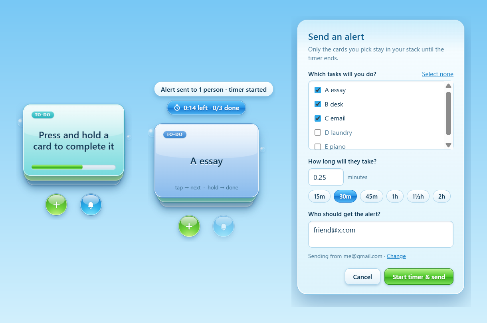

# Card Stack

A little to-do pet that sits on your Windows desktop: a stack of glossy cards, one task per card.

- **Tap** a card to flip to the next one
- **Hold** a card to complete it
- **Drag** a card to move the pet anywhere on your screen
- **Send an alert**: pick the tasks you're committing to and how long they'll take, and Card Stack emails your friends. Until the timer ends, only those cards stay in your stack. When time's up, it replies on the same email thread with how many you finished.



## Install (Windows)

1. **[Download Card-Stack-Setup.exe](https://github.com/mrmangoforpresident/card-stack/releases/latest/download/Card-Stack-Setup.exe)**
2. Open it. Card Stack installs and opens. It also starts with Windows (you can turn that off from the right-click menu).

> **"Windows protected your PC"?** The installer isn't code-signed (signing certificates cost money), so Windows warns about it. Click **More info**, then **Run anyway**.

## Setting up email alerts

Alerts are sent from your own email account. The first time you press the alert (bell) button, Card Stack asks for:

- **Your email address**
- **An app password**. For Gmail, turn on 2-Step Verification, then create one at [myaccount.google.com/apppasswords](https://myaccount.google.com/apppasswords). Your normal Gmail password won't work.

The mail server is filled in automatically for Gmail, Outlook, Yahoo and iCloud. Your password is stored encrypted on your PC and is only ever sent to your own mail server.

## Tips

- Right-click a card to edit, complete or delete it.
- Right-click anywhere, or use the tray icon by the clock, for **Always on top**, **Start with Windows**, **Reset position** and **Quit**.
- Click the timer to finish a focus session early.
- Card Stack has to be running when the timer ends for the results email to be sent. If it's closed, the email goes out the next time you open it.
- Your cards are saved in `%APPDATA%\CardStack`.

## Run from source

```bash
npm install
npm start
```

Build the installer with `npm run dist`; it appears in `dist/`.
